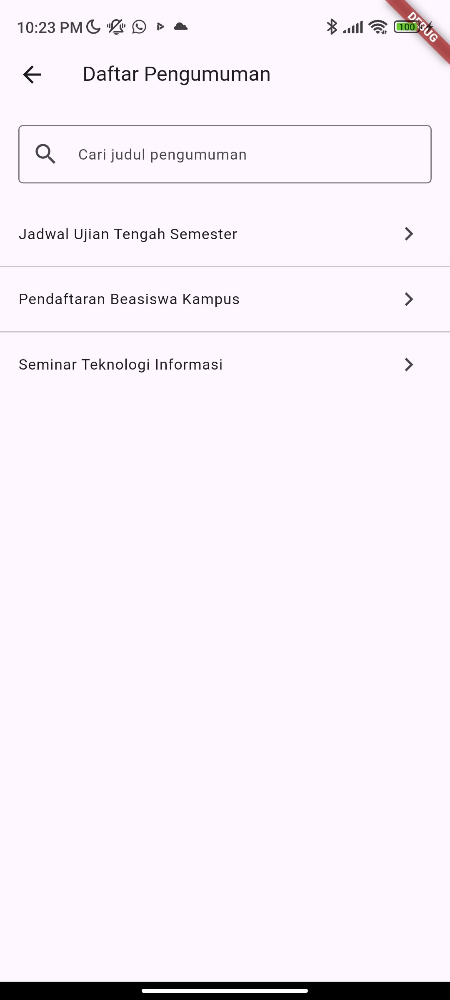
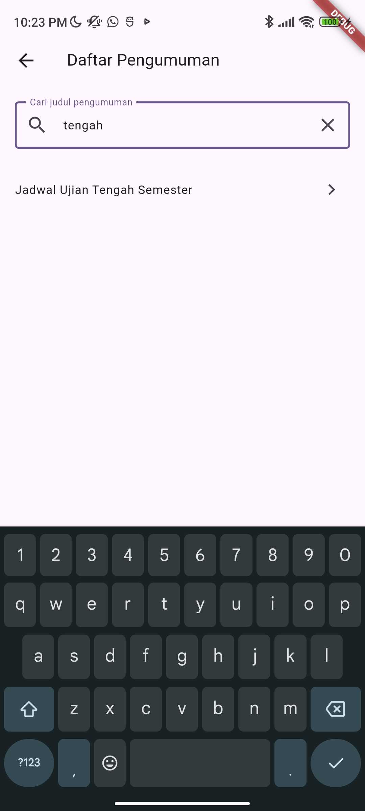
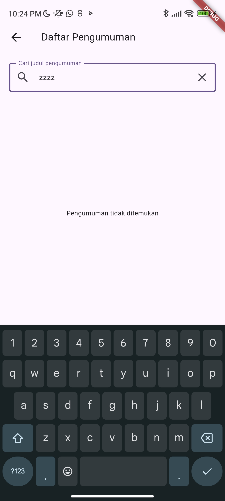
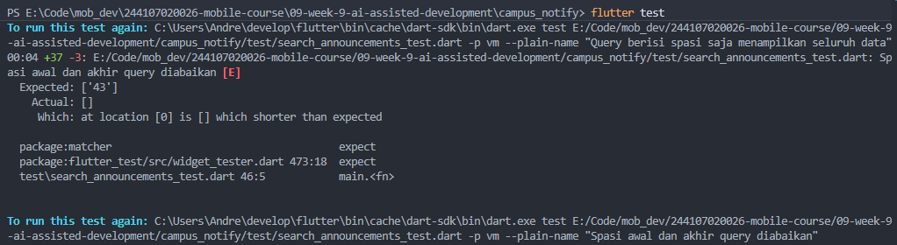
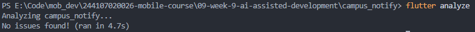
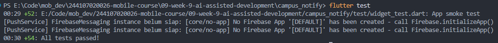
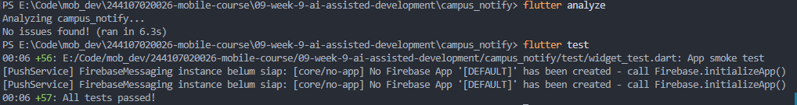

# Praktikum 1: Prompt dan context engineering

1. Formula 5 slot

```
Peran:
Kamu adalah senior Flutter developer yang memahami Clean Architecture,
Riverpod, dan pengujian Flutter.

Konteks:
Saya mengerjakan praktikum Week 9 menggunakan Campus Notify hasil Week 7.
Instruksi search judul notes saya adaptasi menjadi search judul pengumuman.

Proyek sudah memiliki layer data, domain, dan presentation.
Halaman pengumuman saat ini menampilkan detail contoh berdasarkan ID.
Daftar pengumuman belum tersedia.
AnnouncementRepository yang ada menangani FCM dan registrasi perangkat,
bukan pengambilan daftar pengumuman.

Saya lampirkan struktur folder, dependencies, kontrak repository,
provider, halaman, dan rute yang relevan di bawah.

Tugas:
Tambahkan satu fitur kecil berupa pencarian judul pengumuman.
Gunakan daftar data contoh lokal dan tampilkan empty state jika tidak cocok.
Hubungkan daftar dengan navigasi yang diperlukan.

Kriteria keberhasilan:
1. Query kosong menampilkan seluruh data.
2. Pencarian berdasarkan judul dan tidak membedakan huruf besar/kecil.
3. Spasi awal dan akhir query diabaikan.
4. Query tidak cocok menampilkan "Pengumuman tidak ditemukan".
5. Menghapus query memulihkan seluruh daftar.
6. Daftar sumber tidak berubah akibat pencarian.

Batas:
- Pertahankan Clean Architecture dan pola Riverpod proyek.
- Domain berupa Dart murni, tanpa Flutter/Riverpod/Dio/SQLite.
- Aturan pencarian berada di use case domain.
- Widget menangani tampilan dan input.
- Notifier mengelola state.
- Pisahkan kontrak daftar pengumuman dari repository FCM.
- Jangan mengubah auth, alur FCM, atau konfigurasi Firebase.
- Jangan menambah package atau backend.
- Hindari fungsi panjang; pecah berdasarkan tanggung jawab.
- Jangan mengasumsikan method atau endpoint yang belum tersedia.

Output:
1. Asumsi dan daftar file yang ditambah/diubah.
2. Kode per file.
3. Unit test untuk perilaku pencarian.
4. Satu widget test untuk empty state.
5. Cara menjalankan dan menguji.
6. Penjelasan alur data dan tanggung jawab setiap layer.
```

2. Buruk vs baik

Contoh prompt buruk:

> Buatkan fitur search pengumuman yang bagus.

Prompt tersebut tidak menjelaskan sumber data, aturan pencarian, batas arsitektur, atau hasil yang diharapkan.

Prompt pada nomor 1 diperjelas dengan konteks Campus Notify, sumber data contoh lokal, aturan pencarian case-insensitive, empty state, batas perubahan, serta kebutuhan pengujian. Dengan demikian, hasil AI memiliki kriteria yang dapat diverifikasi.

3. Beri konteks, bukan secret

Konteks yang akan disertakan:
- Struktur folder fitur announcements.
- Bagian SDK dan dependencies dari pubspec.yaml.
- Kontrak AnnouncementRepository yang saat ini menangani FCM.
- Kode halaman pengumuman, provider, dan rute yang relevan.

Batas perubahan:
- Auth, alur FCM, dan konfigurasi Firebase tidak diubah.
- Implementasi mengikuti pembagian data, domain, dan presentation.

Token FCM, JWT, password, dan kredensial privat tidak disertakan. Jika diperlukan dalam potongan kode, nilainya diganti placeholder.


# Praktikum 2: Generate dan verifikasi search

1. Generate satu fitur kecil

Output awal di [ai-output-awal.md](docs/ai-output-awal.md)

2. Verifikasi 6 langkah

| No. | Langkah verifikasi | Hasil | Status |
| --- | --- | --- | --- |
| 1 | Baca setiap baris kode | Alur pencarian dipisahkan menjadi repository, use case, notifier, dan widget. Normalisasi query dilakukan di use case. | Sesuai |
| 2 | Cek import | File domain baru tidak mengimpor Flutter, Dio, SQLite, atau Riverpod. | Lulus |
| 3 | Cek API | Method yang digunakan tersedia pada Dart, package terpasang, atau kontrak repository baru. Tidak ditemukan method fiktif. | Lulus |
| 4 | Jalankan `flutter analyze` | Hasil `No issues found!`. | Lulus |
| 5 | Test search sukses dan tidak cocok | 9 unit test search, 1 test notifier, dan 1 widget test lulus. Total seluruh suite: 54 test lulus. | Lulus |
| 6 | Uji manual query kosong, cocok, dan tidak cocok | Query kosong menampilkan tiga pengumuman; `tengah` menampilkan jadwal ujian; `zzzz` menampilkan empty state. | Lulus |

| Query kosong | Query cocok | Query tidak cocok |
| --- | --- | --- |
|  |  |  |

Pada verifikasi awal, seluruh 54 test lulus. Setelah tindak lanjut AI Challenge menambahkan tiga test, hasil akhir menjadi 57 test lulus dengan analyzer bersih. Kasus debugging normalisasi query didokumentasikan pada Praktikum 3.

3. Contoh test bukti

query dengan spasi di tepi ikut dicocokkan. test tersebut seharusnya gagal karena hasil aktual [], sedangkan hasil yang diharapkan ['43'].


# Praktikum 3: Debug dan refactor

1. Debug dengan test merah

```
Lanjutkan Praktikum 3: Debug dan refactor pada proyek
09-week-9-ai-assisted-development/campus_notify.

Kasus debugging:
Pada versi kode dalam screenshot, normalisasi query hanya menggunakan:

final normalizedQuery = query.toLowerCase();

Pencarian dengan query '  beasiswa  ' menghasilkan [],
padahal hasil yang diharapkan adalah pengumuman dengan ID '43'.
Query yang hanya berisi spasi juga seharusnya menampilkan seluruh data.

Bukti:
Saya lampirkan screenshot kode dan output test gagal.
Test terkait berada pada test/search_announcements_test.dart.

Periksa juga kondisi file saat ini. Jika trim() sudah tersedia,
jelaskan bahwa kode saat ini sudah mengandung perbaikan.
Jangan menghapus perbaikan atau membuat ulang bug.

Tugas:
1. Jelaskan reproduksi dan akar masalah berdasarkan bukti.
2. Bandingkan kondisi sebelum dan sesudah perbaikan.
3. Pertahankan test pembukti dan seluruh ekspektasinya.
4. Periksa pembagian tanggung jawab:
   - widget: tampilan dan input;
   - notifier: state;
   - use case domain: normalisasi dan filter;
   - repository: sumber data.
5. Refactor hanya jika ditemukan masalah nyata.
   Jangan membuat perubahan tambahan hanya untuk memenuhi bagian refactor.
6. Periksa fungsi di atas 40 baris pada fitur ini dan pecah jika
   memiliki beberapa tanggung jawab.
7. Jalankan:
   flutter test test/search_announcements_test.dart
   flutter analyze
   dart format --set-exit-if-changed .
   flutter test

Batas:
Jangan mengubah auth, FCM, Firebase, dependencies, atau ekspektasi test.
Jika format belum sesuai, rapikan lalu ulangi pemeriksaan.
Jangan mengisi README, AI log, AI Challenge, atau refleksi.

Output:
Ringkasan akar masalah, perubahan yang benar-benar dilakukan,
hasil pemeriksaan arsitektur, dan hasil aktual setiap perintah.
Bedakan hasil yang sudah dijalankan dari langkah yang belum dilakukan.
```

Kasus debugging berfokus pada normalisasi query pencarian. Pada versi sebelum perbaikan, query hanya diubah menjadi huruf kecil tanpa menghapus spasi awal dan akhir.

| Aspek | Hasil pemeriksaan |
| --- | --- |
| Input pemicu | `'  beasiswa  '` |
| Hasil yang diharapkan | Pengumuman dengan ID `'43'` |
| Hasil aktual sebelum perbaikan | Daftar kosong `[]` |
| Akar masalah | Spasi query ikut diperiksa oleh `contains()` |
| Perbaikan | Menggunakan `query.trim().toLowerCase()` |
| Test pembukti | `Spasi awal dan akhir query diabaikan` |

Output AI di [docs/ai-output-praktikum3.md](docs/ai-output-praktikum3.md)

2. Refactor ke layer yang benar

Tidak ada yang perlu direfactor.

3. Verifikasi akhir

| Pemeriksaan | Hasil |
| --- | --- |
| Unit test pencarian | 9 test lulus |
| `flutter analyze` |  |
| Pemeriksaan format | Pemeriksaan lib test berhasil. Pemeriksaan seluruh direktori terkendala artefak build |
| Seluruh test |  |

# AI Challenge
## AI Prompt Challenge

```
Peran:
Senior Flutter developer yang memahami Clean Architecture,
Riverpod, dan pengujian.

Konteks:
- Fitur menggunakan tiga data contoh lokal.
- Search berdasarkan sebagian judul, case-insensitive,
  serta mengabaikan spasi awal/akhir query.
- Query kosong menampilkan seluruh daftar.
- Query tidak cocok menampilkan empty state.
- Menghapus query memulihkan seluruh daftar.
- Kontrak daftar pengumuman terpisah dari kontrak FCM.
- Detail pengumuman masih menggunakan halaman contoh lama.
- Praktikum 3 mempertahankan normalisasi trim().toLowerCase().
- Hasil pemeriksaan terakhir: 9 unit test search dan
  54 test keseluruhan lulus; analyzer bersih.
- Pemeriksaan format lib dan test berhasil.
  Pemeriksaan seluruh direktori terkendala artefak build.

Tugas:
Baca implementasi dan test fitur yang sebenarnya, termasuk perubahan
rute dan halaman yang berhubungan dengan pencarian.

Fokus review:
1. Kebenaran perilaku search dan state.
2. Pembagian tanggung jawab dan arah dependensi.
3. Kecukupan unit test, widget test, dan test navigasi.
4. Lifecycle controller/provider dan pemulihan query saat kembali
   dari detail.

Output:
Berikan sampai tiga temuan konkret.
Untuk setiap temuan, sertakan:
- ID temuan;
- file dan nomor baris;
- kategori: bug, celah test, atau peningkatan opsional;
- tingkat: blocker atau saran;
- pemicu dan dampak;
- bukti dari kode atau test;
- perbaikan terkecil yang disarankan.

Jika tidak ditemukan bug, nyatakan dengan jelas.
Jika relevan, boleh berikan alternatif peningkatan opsional
beserta manfaat dan biayanya.
Jangan membuat temuan untuk memenuhi jumlah.

Batas:
- Tahap ini hanya review; jangan mengubah file.
- Jangan mengubah auth, FCM, Firebase, atau dependencies.
- Jangan menyebut kasus trim sebagai bug baru jika kode saat ini
  sudah benar.
- Jangan menganggap detail contoh sebagai fitur backend yang hilang.
- Abaikan preferensi gaya penulisan.
- Jangan mengisi README atau AI log.
- Bedakan pemeriksaan yang dijalankan dari dugaan yang belum terbukti.
```

## AI Verification Checklist

1. Minimal 1 temuan AI terbukti benar (bukti grep/test) lalu diperbaiki.

AC-01 dan AC-02 terbukti sebagai celah pengujian. Ditambahkan dua test navigasi serta satu widget test untuk pencarian yang cocok. Setelah penambahan, seluruh 57 test lulus.

2. Minimal 1 temuan AI ditolak dengan alasan teknis tertulis.

OP-02, yaitu menampilkan jumlah hasil pencarian, ditolak untuk cakupan saat ini. Data hanya tiga pengumuman; daftar hasil dan empty state sudah memenuhi kebutuhan tanpa tambahan label UI.

3. Keputusan tiap file: terima, terima + refactor, atau tolak + tulis manual.

Kode produksi diterima karena pembagian layer sudah sesuai. Test diterima dengan penambahan cakupan untuk AC-01 dan AC-02.

4. Mampu menjelaskan tiap keputusan tanpa membuka AI.

### Tanggung jawab teknis (pada folder docs/):

1. simpan prompt

```
Review fitur pencarian judul pengumuman berikut sebagai senior Flutter dev.

Konteks:
Campus Notify, feature-first, Clean Architecture, dan Riverpod.
Sumber daftar adalah data contoh lokal.
Kontrak FCM terpisah dari kontrak daftar pengumuman.

Fokus:
Kebenaran perilaku, arsitektur, dan kecukupan test.
Abaikan preferensi gaya penulisan.

Berikan sampai 3 temuan konkret dengan:
1. Lokasi kode.
2. Pemicu dan dampaknya.
3. Level blocker atau saran.
4. Cara membuktikan melalui pemeriksaan kode atau test.
5. Usulan perbaikan.

Bedakan bug dari peningkatan opsional.
Jangan mengada-adakan temuan untuk memenuhi jumlah.
```

2. output AI

Output di [ai-review-challenge.md](ai-review-challenge.md)

3. tabel usulan-vs-keputusan

| ID | Temuan | Bukti verifikasi | Keputusan | Alasan teknis |
|---|---|---|---|---|
| AC-01 | Navigasi dan pemulihan query belum diuji | Widget test menggunakan `MaterialApp(home: ...)`, tanpa router dan tanpa membuka detail. Test detail lama hanya memeriksa konten. | Terima | Perubahan navigasi dapat merusak alur kembali tanpa terdeteksi test yang tersedia. |
| AC-02 | Widget test belum menguji query yang cocok | Input yang diuji hanya `judul tidak tersedia`; belum ada pemeriksaan judul hasil pencarian yang cocok. | Terima | Unit test domain belum membuktikan bahwa input dan hasil terhubung dengan benar pada UI. |

4. bukti analyze + test


# Refactoring, testing, dan error umum

## Refactoring Challenge

1. Perkecil hasil AI di atas 80 baris menjadi fungsi/use case kecil yang bisa diuji.

Implementasi sudah dipisahkan menjadi entity, repository, use case, notifier, dan widget. Fungsi produksi fitur pencarian tidak melebihi 40 baris, sehingga tidak diperlukan pemecahan fungsi tambahan.

2. Pindahkan filter/search dari widget ke use case domain yang murni.

Normalisasi query dan filter judul sudah berada pada `SearchAnnouncements`. Widget menangani input dan tampilan sedangkan notifier mengelola state. Tidak diperlukan pemindahan logika tambahan.

3. Hapus import lintas layer dan pastikan analyze tetap bersih.

Domain hanya mengimpor entity dan kontrak repository domain, tanpa Flutter, Riverpod, Dio, atau SQLite. Tidak ditemukan import yang perlu dihapus. Hasil `flutter analyze` bersih.

## Testing

| Pengujian | Cakupan |
| --- | --- |
| Unit test search | Query kosong, spasi, kapital, pencarian judul, tidak cocok, pemulihan daftar, dan sumber tidak berubah |
| Test notifier | Perubahan query, hasil pencarian, dan pemulihan state |
| Widget test | Empty state, tombol hapus, dan hasil pencarian yang cocok |
| Test navigasi | Daftar → detail → kembali, query tetap tersimpan, serta fallback ke Home |

Hasil pemeriksaan setelah AI Challenge:

| Pemeriksaan | Hasil |
| --- | --- |
| `flutter analyze` | No issues found |
| `dart format --set-exit-if-changed lib test` | 43 file diperiksa, 0 berubah |
| `flutter test` | 57 test lulus |

Pemeriksaan format seluruh direktori terkendala artefak `build`,
sehingga pemeriksaan dilakukan langsung pada `lib` dan `test`.

## Checklist verifikasi mandiri

- [x] Prompt lima slot dan konteks tersimpan di dokumentasi.
- [x] Analyzer bersih dan seluruh test lulus.
- [x] Temuan AC-01 dan AC-02 diverifikasi serta ditindaklanjuti.
- [x] Usulan OP-02 ditolak dengan alasan teknis tertulis.
- [x] Bukti uji manual query kosong, cocok, dan tidak cocok tersedia.

# Tugas, refleksi, dan referensi

## Refleksi

1. Satu halusinasi AI apa yang Anda temukan dan bagaimana membuktikannya?

Pada output awal yang diperiksa, saya belum menemukan halusinasi API. Kasus debugging yang didokumentasikan adalah normalisasi query tanpa trim(). Input '  beasiswa  ' menghasilkan daftar kosong, sedangkan test mengharapkan pengumuman ID '43'. Screenshot test gagal menjadi bukti kondisi sebelum perbaikan. Normalisasi trim().toLowerCase() menangani spasi tepi sekaligus mempertahankan pencarian case-insensitive.

2. Prompt mana yang paling membantu dan apa yang Anda ubah?

Prompt debugging paling membantu karena menyertakan input pemicu, hasil aktual, hasil yang diharapkan, nama test, dan screenshot kegagalan. Saya memperjelas bahwa kondisi file saat ini harus diperiksa terlebih dahulu dan perbaikan yang sudah tersedia tidak boleh dihapus. Konteks tersebut membuat pembahasan terarah pada penyebab masalah dan bukti pengujian.

3. Satu refactor apa yang Anda lakukan pada kode AI?

Pada Praktikum 3 tidak dilakukan refactor tambahan karena normalisasi dan filter sudah berada pada use case domain, notifier mengelola state, dan widget menangani input serta tampilan. Perubahan normalisasi query merupakan perbaikan perilaku. Saya mempertahankan struktur yang sudah sesuai agar tidak menambah perubahan tanpa kebutuhan.

4. Keputusan terima/tolak mana yang paling sulit?

Keputusan yang paling membutuhkan pertimbangan adalah menolak usulan menampilkan jumlah hasil pencarian. Usulan tersebut dapat membantu pengguna, tetapi fitur saat ini hanya menggunakan tiga data lokal. Daftar hasil dan empty state sudah memenuhi kebutuhan, sehingga saya mempertahankan tampilan yang ada dan memprioritaskan kelengkapan test AC-01 serta AC-02.