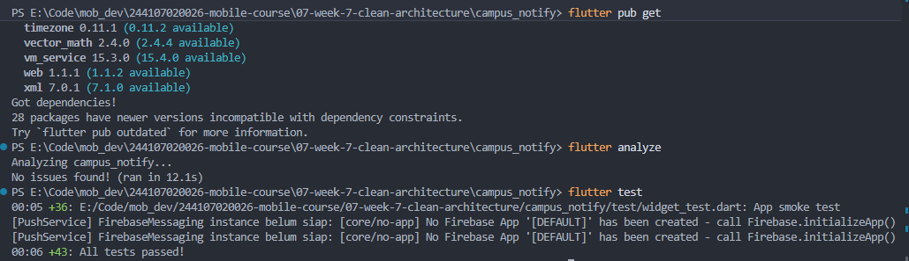
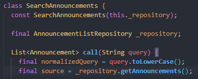

## 1. Tujuan dan cakupan
Menambahkan satu fitur kecil berupa pencarian judul pengumuman.

## 2. Kondisi awal proyek


## 3. Prompt awal dan konteks
```
Peran:
Kamu adalah senior Flutter developer yang memahami Clean Architecture,
Riverpod, dan pengujian Flutter.

Konteks:
Saya mengerjakan praktikum Week 9 menggunakan Campus Notify hasil Week 7.
Instruksi search judul notes saya adaptasi menjadi search judul pengumuman.

Proyek sudah memiliki layer data, domain, dan presentation.
Halaman pengumuman saat ini menampilkan detail contoh berdasarkan ID.
Daftar pengumuman belum tersedia.
AnnouncementRepository yang ada menangani FCM dan registrasi perangkat,
bukan pengambilan daftar pengumuman.

Saya lampirkan struktur folder, dependencies, kontrak repository,
provider, halaman, dan rute yang relevan di bawah.

Tugas:
Tambahkan satu fitur kecil berupa pencarian judul pengumuman.
Gunakan daftar data contoh lokal dan tampilkan empty state jika tidak cocok.
Hubungkan daftar dengan navigasi yang diperlukan.

Kriteria keberhasilan:
1. Query kosong menampilkan seluruh data.
2. Pencarian berdasarkan judul dan tidak membedakan huruf besar/kecil.
3. Spasi awal dan akhir query diabaikan.
4. Query tidak cocok menampilkan "Pengumuman tidak ditemukan".
5. Menghapus query memulihkan seluruh daftar.
6. Daftar sumber tidak berubah akibat pencarian.

Batas:
- Pertahankan Clean Architecture dan pola Riverpod proyek.
- Domain berupa Dart murni, tanpa Flutter/Riverpod/Dio/SQLite.
- Aturan pencarian berada di use case domain.
- Widget menangani tampilan dan input.
- Notifier mengelola state.
- Pisahkan kontrak daftar pengumuman dari repository FCM.
- Jangan mengubah auth, alur FCM, atau konfigurasi Firebase.
- Jangan menambah package atau backend.
- Hindari fungsi panjang; pecah berdasarkan tanggung jawab.
- Jangan mengasumsikan method atau endpoint yang belum tersedia.

Output:
1. Asumsi dan daftar file yang ditambah/diubah.
2. Kode per file.
3. Unit test untuk perilaku pencarian.
4. Satu widget test untuk empty state.
5. Cara menjalankan dan menguji.
6. Penjelasan alur data dan tanggung jawab setiap layer.
```

## 4. Output awal AI
Output awal di [ai-output-awal.md](ai-output-awal.md)

## 5. Verifikasi awal
| No. | Langkah verifikasi | Hasil | Status |
| --- | --- | --- | --- |
| 1 | Baca setiap baris kode | Alur pencarian dipisahkan menjadi repository, use case, notifier, dan widget. Normalisasi query dilakukan di use case. | Sesuai |
| 2 | Cek import | File domain baru tidak mengimpor Flutter, Dio, SQLite, atau Riverpod. | Lulus |
| 3 | Cek API | Method yang digunakan tersedia pada Dart, package terpasang, atau kontrak repository baru. Tidak ditemukan method fiktif. | Lulus |
| 4 | Jalankan `flutter analyze` | Hasil `No issues found!`. | Lulus |
| 5 | Test search sukses dan tidak cocok | 9 unit test search, 1 test notifier, dan 1 widget test lulus. Total seluruh suite: 54 test lulus. | Lulus |
| 6 | Uji manual query kosong, cocok, dan tidak cocok | Pengujian langsung pada aplikasi beserta screenshot belum dilakukan. | Belum dilakukan |

## 6. Bug dan bukti test merah
### Kasus debugging: spasi pada query

Pada versi sebelum perbaikan, normalisasi menggunakan
`query.toLowerCase()`. Query `'  beasiswa  '` menghasilkan daftar
kosong, sedangkan test mengharapkan pengumuman dengan ID `'43'`.

Penyebabnya adalah spasi awal dan akhir belum dibuang sebelum
pencocokan judul. Test yang sudah tersedia menjadi bukti kegagalan
perilaku tersebut.




## 7. Perbaikan dan refactor
### Prompt debugging
```
Lanjutkan Praktikum 3: Debug dan refactor pada proyek
09-week-9-ai-assisted-development/campus_notify.

Kasus debugging:
Pada versi kode dalam screenshot, normalisasi query hanya menggunakan:

final normalizedQuery = query.toLowerCase();

Pencarian dengan query '  beasiswa  ' menghasilkan [],
padahal hasil yang diharapkan adalah pengumuman dengan ID '43'.
Query yang hanya berisi spasi juga seharusnya menampilkan seluruh data.

Bukti:
Saya lampirkan screenshot kode dan output test gagal.
Test terkait berada pada test/search_announcements_test.dart.

Periksa juga kondisi file saat ini. Jika trim() sudah tersedia,
jelaskan bahwa kode saat ini sudah mengandung perbaikan.
Jangan menghapus perbaikan atau membuat ulang bug.

Tugas:
1. Jelaskan reproduksi dan akar masalah berdasarkan bukti.
2. Bandingkan kondisi sebelum dan sesudah perbaikan.
3. Pertahankan test pembukti dan seluruh ekspektasinya.
4. Periksa pembagian tanggung jawab:
   - widget: tampilan dan input;
   - notifier: state;
   - use case domain: normalisasi dan filter;
   - repository: sumber data.
5. Refactor hanya jika ditemukan masalah nyata.
   Jangan membuat perubahan tambahan hanya untuk memenuhi bagian refactor.
6. Periksa fungsi di atas 40 baris pada fitur ini dan pecah jika
   memiliki beberapa tanggung jawab.
7. Jalankan:
   flutter test test/search_announcements_test.dart
   flutter analyze
   dart format --set-exit-if-changed .
   flutter test

Batas:
Jangan mengubah auth, FCM, Firebase, dependencies, atau ekspektasi test.
Jika format belum sesuai, rapikan lalu ulangi pemeriksaan.
Jangan mengisi README, AI log, AI Challenge, atau refleksi.

Output:
Ringkasan akar masalah, perubahan yang benar-benar dilakukan,
hasil pemeriksaan arsitektur, dan hasil aktual setiap perintah.
Bedakan hasil yang sudah dijalankan dari langkah yang belum dilakukan.
```

### Output
Output awal di [ai-output-praktikum3.md](ai-output-praktikum3.md)

### Perbaikan
Normalisasi query menggunakan `query.trim().toLowerCase()`. Ekspektasi test dipertahankan agar perbaikan mengikuti perilaku yang ditentukan.

### Pemeriksaan arsitektur
Tidak ada arsitektur yang diubah atau refactor.

### Hasil pengujian


## 8. Prompt dan output review AI


## 9. Keputusan per temuan


## 10. Keputusan per file


## 11. Hasil pemeriksaan akhir


