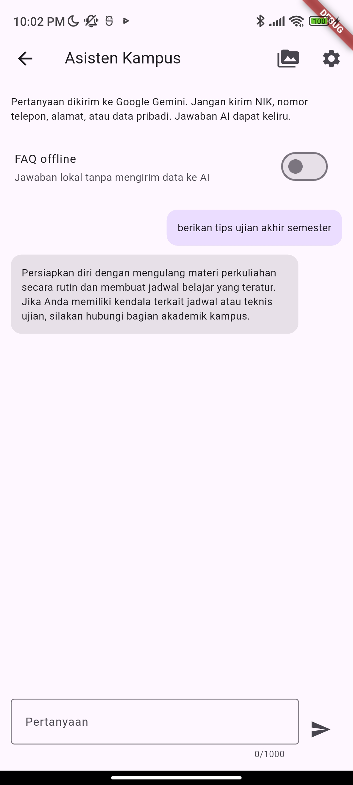
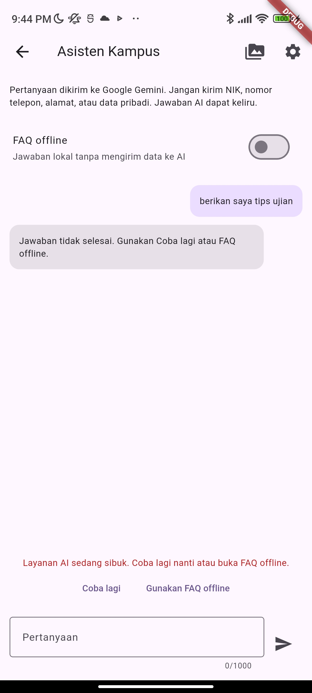
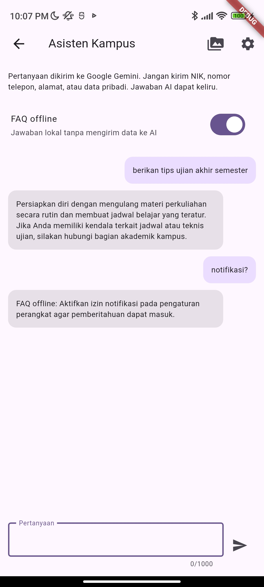

# Praktikum: Chat interface dengan AI

1. Tambahkan dependensi

```yaml
http: ^1.2.0
flutter_secure_storage: ^11.2.0
flutter_riverpod: ^3.4.3
image_picker: ^1.2.4
record: ^7.1.2
path_provider: ^2.1.5
```

Versi `flutter_secure_storage` dan `flutter_riverpod` mengikuti proyek pertemuan 7. `flutter_riverpod` digunakan untuk widget Flutter dan provider tanpa menambah paket `riverpod` secara terpisah.

2. Buat AI service

Implementasi di [lib/ai/ai_service.dart](campus_notify/lib/ai/ai_service.dart).

| Method | Fungsi |
| --- | --- |
| `saveApiKey()` | Menyimpan kunci ke secure storage |
| `deleteApiKey()` | Menghapus kunci dan cache jawaban |
| `askStream()` | Membaca potongan respons SSE dari Gemini |
| `ask()` | Menggabungkan respons menjadi satu teks |
| `recognizeText()` | Mengambil teks dari gambar |
| `speechToText()` | Mengubah rekaman menjadi teks |
| `describeImage()` | Membuat deskripsi singkat gambar |

Model bawaan adalah `gemini-3.5-flash-lite`. API key dikirim melalui header `x-goog-api-key`, bukan ditulis pada kode sumber atau URL. Service menggunakan `streamGenerateContent` untuk chat dan `generateContent` untuk file.

3. Buat chat screen

Implementasi di [lib/features/chat_screen.dart](campus_notify/lib/features/chat_screen.dart).

Halaman berisi daftar pesan, kolom pertanyaan, tombol kirim, indikator loading, dan pilihan FAQ offline. Jawaban bertambah mengikuti potongan respons server. Tombol kirim dinonaktifkan selama permintaan berjalan agar tidak ada pengiriman ganda.

Jika terjadi kesalahan, halaman menampilkan pesan yang mudah dipahami, tombol `Coba lagi`, dan tombol `Gunakan FAQ offline`. Pertanyaan yang mengandung pola nomor panjang atau email ditolak sebelum dikirim.

4. Pengaturan API key

Halaman [Pengaturan AI](campus_notify/lib/features/ai_settings_screen.dart) dibuka melalui ikon pengaturan pada chat. Input kunci disamarkan dan dibersihkan setelah disimpan. Kunci yang sudah tersimpan tidak ditampilkan kembali. Tombol hapus menghapus kunci dari perangkat.

5. Menjalankan aplikasi

```bash
cd 10-week-10-ai-feature-integration/campus_notify
flutter pub get
flutter run
```

Alur penggunaan:

- Masuk melalui halaman login Campus Notify.
- Pilih `Buka Asisten Kampus` pada halaman utama.
- Buka `Pengaturan AI`, masukkan API key Gemini, lalu tekan `Simpan`.
- Kembali ke chat dan ketik pertanyaan tanpa data pribadi.
- Aktifkan `FAQ offline` untuk memakai jawaban lokal tanpa koneksi AI.

Model dapat diganti saat menjalankan aplikasi:

```bash
flutter run --dart-define=GEMINI_MODEL=gemini-3.5-flash-lite
```

Pada Android, minimum SDK ditetapkan setidaknya 24 sesuai kebutuhan `image_picker`. Plugin Google Services hanya diaktifkan jika `android/app/google-services.json` tersedia. Chat dan FAQ dapat dipakai tanpa konfigurasi FCM; notifikasi Firebase memerlukan konfigurasi Firebase yang sesuai. Berkas konfigurasi tersebut tidak disertakan dalam salinan tugas.

# OCR, Speech-to-Text, dan Image Understanding

1. OCR

Pilih ikon media pada chat, lalu ambil gambar dari kamera atau galeri. Pratinjau gambar ditampilkan sebelum pengiriman. Tombol `Baca teks (OCR)` mengirim gambar ke Gemini dengan instruksi menyalin teks yang terbaca tanpa menebak bagian yang tidak jelas.

2. Speech-to-Text

Tekan `Rekam suara` dan ucapkan kalimat singkat. Rekaman berhenti ketika tombol hentikan ditekan atau setelah 15 detik. Tombol `Transkripsikan` mengirim rekaman WAV untuk diubah menjadi teks. Rekaman sementara dihapus ketika halaman ditutup atau diganti dengan rekaman baru.

3. Image Understanding

Setelah gambar dipilih, tekan `Deskripsikan gambar`. Hasilnya berupa penjelasan singkat isi gambar tanpa menebak identitas orang.

Implementasi ketiga latihan berada pada [lib/features/media_screen.dart](campus_notify/lib/features/media_screen.dart). File dibatasi maksimal 5 MB. Dialog persetujuan ditampilkan sebelum setiap pengiriman file ke Google Gemini. Android memiliki izin mikrofon, sedangkan iOS memiliki keterangan penggunaan kamera, galeri, dan mikrofon.

# Privasi, biaya, error handling, dan fallback

1. Tabel risiko dan mitigasi

| Risiko | Mitigasi yang diterapkan |
| --- | --- |
| Data pengguna terkirim | Peringatan pada chat, pemeriksaan pola nomor panjang dan email, serta persetujuan sebelum unggah file |
| API key bocor | Secure storage, input kunci disamarkan, tanpa kunci di source code atau log |
| Biaya bertambah | Maksimal 20 request per sesi service, input 1000 karakter, output 1024 token, file 5 MB, dan rekaman 15 detik |
| Pertanyaan berulang | Cache maksimal 10 jawaban chat di memori selama sesi service |
| API error atau kuota penuh | Pesan ramah untuk kegagalan koneksi, timeout, penolakan akses, HTTP 429, dan error server |
| Jawaban kosong atau tidak lengkap | Respons kosong, diblokir, dan terpotong ditandai sebagai kegagalan dan tidak disimpan dalam cache |
| Informasi tidak akurat | Prompt melarang mengarang informasi resmi; UI mengingatkan bahwa jawaban AI dapat keliru |
| Tidak ada koneksi | FAQ offline untuk pengumuman, notifikasi, jadwal, dan beasiswa |

Pemeriksaan teks hanya mengenali pola tertentu. Alamat atau data pribadi dalam gambar dan suara tidak otomatis disamarkan. Karena itu, unggahan memakai pemberitahuan privasi dan persetujuan. Riwayat chat serta cache tidak disimpan ke disk. Cache dan hitungan request direset ketika service ditutup, sehingga batas ini merupakan pengendalian sederhana untuk praktikum, bukan kuota harian akun.

2. Fallback

```text
Permintaan AI gagal
        |
Pesan kesalahan + Coba lagi + Gunakan FAQ offline
        |
FAQ lokal berdasarkan kata kunci
        |
Jika tidak ditemukan, arahkan ke bagian akademik
```

FAQ memakai data lokal di [lib/ai/offline_faq.dart](campus_notify/lib/ai/offline_faq.dart). Jawaban diberi label `FAQ offline` agar sumbernya jelas. OCR dan transkripsi tetap membutuhkan internet; ketika gagal, input teks pada chat tetap dapat digunakan.

# Pengujian

1. Perintah pemeriksaan

```bash
flutter analyze
dart format --output=none --set-exit-if-changed lib test
flutter test
```

2. Cakupan pengujian

| Pemeriksaan | Hasil |
| --- | --- |
| `flutter analyze` | No issues found |
| Pemeriksaan format `lib` dan `test` | 40 file diperiksa, 0 berubah |
| `flutter test` | 65 test lulus |

| Pengujian | Cakupan |
| --- | --- |
| Service AI | Simpan/hapus kunci, header API key, prompt sistem, streaming, cache, batas request, validasi input, respons kosong, respons terpotong, dan blokir keamanan |
| Error HTTP | Status 400, 403, 404, 429, dan 500 |
| Media | Prompt OCR/deskripsi/transkripsi, MIME type, encoding file, dan batas ukuran |
| Widget chat | Respons bertahap, indikator loading, tombol kirim, pesan gagal, serta perpindahan ke FAQ offline |
| Privasi | Input berpola data sensitif ditolak sebelum memanggil service |
| Fitur sebelumnya | Seluruh test bawaan Campus Notify ikut dijalankan |

Hasil pemeriksaan tersimpan pada [Flutter Analyze](screenshots/flutter_analyze.png), [Dart Format](screenshots/dart_format.png), dan [Flutter Test](screenshots/flutter_test.png). Rincian pelaksanaan tersedia di [docs/verifikasi.md](docs/verifikasi.md).

3. Tampilan dari widget test

Gambar berikut diambil dari widget Flutter dengan service tiruan. Respons streaming dan kegagalan API disimulasikan untuk memeriksa tampilan.

| Respons streaming | Layanan gagal | Fallback offline |
| --- | --- | --- |
|  |  |  |

# Tugas, refleksi, dan referensi

## Refleksi

1. Fitur AI mana yang Anda integrasikan dan mengapa?

Saya mengintegrasikan chat asisten kampus karena pengguna bisa bertanya langsung tentang penggunaan aplikasi dan informasi kampus. Saya juga mencoba OCR, mengubah suara menjadi teks, dan deskripsi gambar agar lebih memahami cara mengirim beberapa jenis input ke AI.

2. Bagaimana Anda melindungi privasi pengguna saat menggunakan AI API?

Saya menyimpan API key di secure storage dan tidak menulisnya di kode. Saya juga memberi peringatan agar pengguna tidak mengirim data pribadi. Pertanyaan dengan pola nomor panjang atau email ditolak, sedangkan gambar dan suara memerlukan persetujuan sebelum dikirim. Data login dan token notifikasi tidak ikut dikirim ke AI.

3. Fallback apa yang Anda sediakan jika layanan AI error?

Saya menyediakan pesan kesalahan, tombol coba lagi, dan FAQ offline. FAQ berisi jawaban sederhana dari data lokal, sehingga masih bisa dipakai tanpa layanan AI. Jika jawabannya belum tersedia, pengguna diarahkan ke bagian akademik.

4. Satu hal yang Anda pelajari tentang UX fitur AI di mobile?

Saya belajar bahwa pengguna perlu tahu apakah aplikasi sedang memproses atau mengalami masalah. Indikator loading dan jawaban yang muncul bertahap membantu pengguna memahami prosesnya. Pesan error yang jelas dan pilihan offline juga membuat aplikasi tetap berguna ketika koneksi bermasalah.