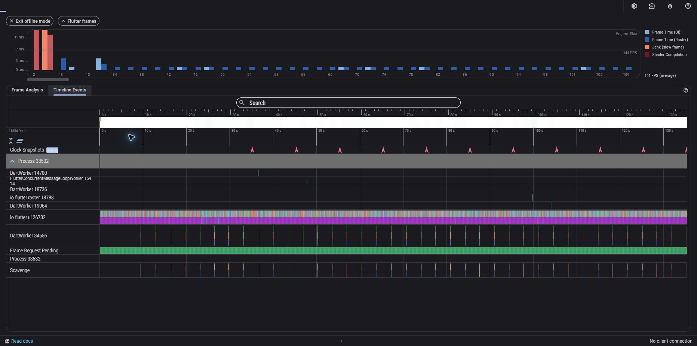
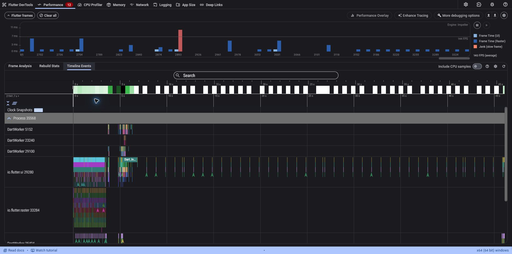

# Praktikum: Optimasi performa aplikasi nyata

1. Baseline profiling

Saya menggunakan Campus Notify dari pertemuan 7. Halaman daftar ditambahkan dengan 120 pengumuman untuk mencoba scroll, membuka detail, kembali, dan refresh. Kode sebelum optimasi tersimpan pada [snapshot baseline](docs/baseline/announcement_list_page.dart.txt).

Profiling dijalankan dalam mode `profile` pada Windows. Runner membuka halaman daftar yang sama tanpa login dan Firebase. Cara menjalankan aplikasi dan mengulang pengukuran tersedia di [docs/verifikasi.md](docs/verifikasi.md).

2. Identifikasi masalah

| Masalah | Bagian kode |
| --- | --- |
| Membuat seluruh widget item ketika daftar dibuka | `List.generate(120, ...)` di dalam `build()` |
| Perubahan penghitung refresh membangun ulang halaman | `setState` pada halaman daftar |
| Widget statis dibuat kembali dan isi item bercampur dalam satu method | Kartu, ikon, subtitle, dan detail ditulis di `build()` halaman |

Temuan dan batas pengukuran dijelaskan pada [docs/performance-findings.md](docs/performance-findings.md).

3. Terapkan optimasi

Implementasi berada di [announcement_list_page.dart](campus_notify/lib/features/announcements/presentation/pages/announcement_list_page.dart).

| Optimasi | Alasan |
| --- | --- |
| `ListView.builder` | Widget item dibuat sesuai kebutuhan tampilan |
| Ekstrak widget | Item dan detail dipisahkan menjadi class yang mudah dibaca |
| Constructor dan widget `const` | Teks serta ikon yang tetap dapat digunakan kembali |
| `ValueListenableBuilder` | Perubahan penghitung hanya memperbarui labelnya |

Daftar memakai data lokal tanpa API dan gambar jaringan. Optimasi difokuskan pada pembuatan widget dan pembaruan tampilan.

4. Verifikasi profiling

Skenario sebelum dan sesudah memakai data serta ukuran jendela yang sama. Masing-masing rekaman menghasilkan 657 frame.

| Pengukuran | Sebelum | Sesudah |
| --- | --- | --- |
| Rata-rata UI/build | 0,482 ms | 0,428 ms |
| Rata-rata raster | 1,777 ms | 1,665 ms |
| Rata-rata durasi frame (`totalSpan`) | 3,267 ms | 3,092 ms |
| Durasi UI/raster tertinggi | 48,664 ms | 37,997 ms |
| Frame kuning pada acuan 60 FPS | 0 | 0 |
| Frame merah pada acuan 60 FPS | 1 | 1 |

Rata-rata durasi frame turun sekitar 5,3% pada pengukuran ini. Jumlah frame lambat masih sama, sehingga optimasi belum menghilangkan seluruh jank. Hasil ini berasal dari satu pengukuran untuk setiap versi.

Screenshot DevTools mencakup sesi yang lebih luas, termasuk proses mengambil snapshot dan waktu tunggu. Angka pada tabel dihitung dari rekaman skenario yang dibatasi oleh integration test. Grafik DevTools memakai layar 144 Hz, sedangkan pengelompokan frame kuning dan merah pada tabel memakai acuan 60 FPS dari materi.

| Sebelum optimasi | Sesudah optimasi |
| --- | --- |
|  |  |

Ringkasan hasil dan tangkapan layar tersedia di README ini.

5. Memory profiling

| Objek | Sebelum 5 kali navigasi | Setelah 5 kali navigasi |
| --- | --- | --- |
| State halaman daftar | 1 | 1 |
| `MaterialPageRoute`, termasuk route daftar | 1 | 1 |
| `AnnouncementDetailPage` pada versi sesudah optimasi | 0 | 0 |

Objek halaman detail tidak menumpuk pada skenario ini. `ValueNotifier` dibersihkan melalui `dispose()`, dan proses refresh memeriksa `mounted` sebelum mengubah nilai. Total heap juga memuat data pengujian dan timeline, sehingga kenaikannya tidak langsung dianggap sebagai kebocoran memori.

# Pengujian

```bash
cd 11-week-11-performance-optimization/campus_notify
flutter analyze --no-pub
flutter test --no-pub
```

| Pemeriksaan | Hasil |
| --- | --- |
| `flutter analyze --no-pub` | No issues found |
| `flutter test --no-pub` | 44 test lulus |
| Integration test mode profile | Skenario baseline dan sesudah optimasi lulus |

Widget test memeriksa pemuatan item bertahap, navigasi detail, pull-to-refresh, dan akses ke item terakhir. Rincian pemeriksaan tersedia pada [docs/verifikasi.md](docs/verifikasi.md).

# Tugas, refleksi, dan referensi

## Refleksi

1. Optimasi mana yang memberikan dampak terbesar dan mengapa?

Menurut saya, penggunaan `ListView.builder` paling membantu karena daftar berisi 120 pengumuman. Sebelumnya, seluruh widget item dibuat sekaligus. Setelah diubah, widget item dibuat sesuai kebutuhan tampilan sehingga pekerjaan saat membuka daftar berkurang.

2. Bagaimana Anda memverifikasi bahwa optimasi benar-benar bekerja (bukan placebo)?

Saya membandingkan hasil profiling sebelum dan sesudah dengan data serta skenario yang sama. Rata-rata durasi frame turun dari 3,267 ms menjadi 3,092 ms. Jumlah frame merah masih satu, jadi belum semua masalah performa teratasi. Saya juga menjalankan pengujian untuk memastikan daftar, detail, dan refresh tetap berfungsi.

3. Trade-off apa yang Anda hadapi (misalnya kompleksitas kode vs performa)?

Kode menjadi sedikit lebih panjang karena item dan detail dipisahkan menjadi widget sendiri. Penggunaan `ValueNotifier` juga memerlukan `dispose()`. Menurut saya, tambahan ini masih mudah dipahami dan membantu membatasi bagian tampilan yang diperbarui.

4. Kapan sebaiknya optimasi premature dihindari?

Optimasi terlalu awal sebaiknya dihindari saat belum ada masalah performa atau hasil pengukuran. Saya lebih memilih menyelesaikan fungsi utama terlebih dahulu. Setelah itu, profiling digunakan untuk menentukan bagian yang perlu diperbaiki agar perubahan kode memiliki alasan yang jelas.
