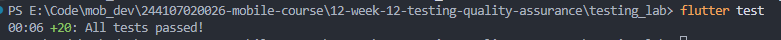
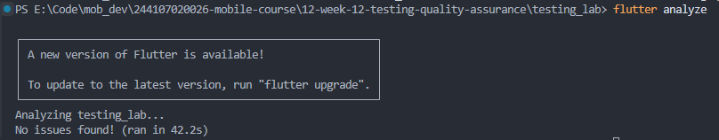
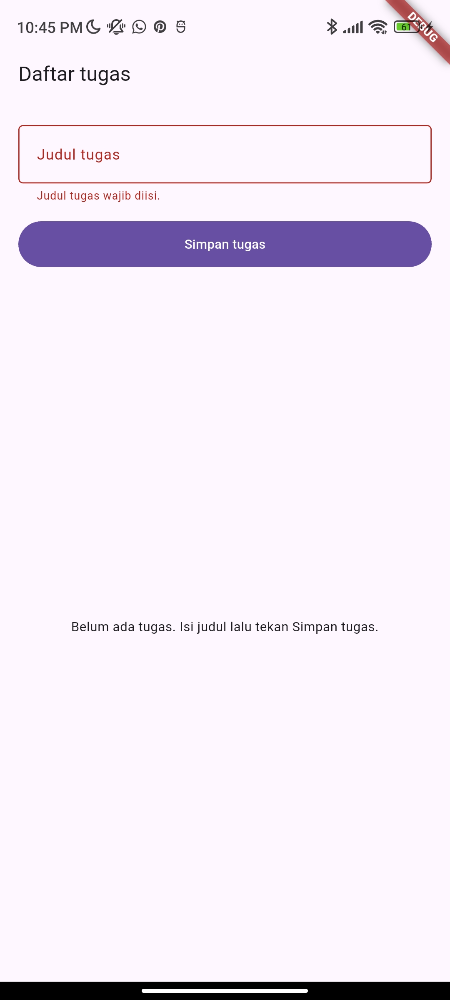
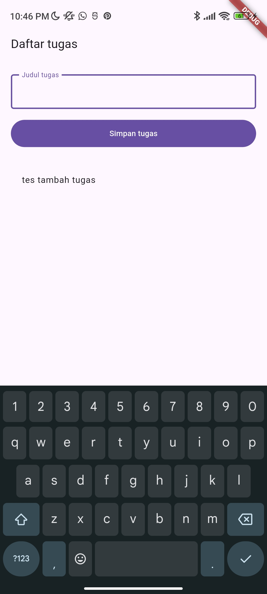

# Praktikum 1 : Pengujian unit dan kasus tepi

1. Validasi di [lib/is_valid_task_title.dart](testing_lab/lib/is_valid_task_title.dart).
2. Pengujian di [test/is_valid_task_title_test.dart](testing_lab/test/is_valid_task_title_test.dart), menggunakan pola Arrange, Act, Assert.

| Input | Hasil |
| --- | --- |
| Teks biasa, seperti Belajar Flutter | Diterima |
| Teks dengan spasi di awal dan akhir | Diterima |
| Judul satu karakter | Diterima |
| Teks kosong | Ditolak |
| Spasi saja | Ditolak |
| Tab dan baris baru saja | Ditolak |

trim() memastikan input yang hanya berisi spasi tidak dianggap sebagai judul.

Pada setiap pengujian, judul disiapkan terlebih dahulu, fungsi validasi dipanggil, lalu hasilnya diperiksa dengan expect. Kasus satu karakter menjadi batas minimum judul yang masih diterima.

# Praktikum 2 : Menguji kode asinkron dan dependensi

1. Sumber data dipisahkan melalui [TaskRepository](testing_lab/lib/task_repository.dart) dan [TaskService](testing_lab/lib/task_service.dart).
2. [FakeTaskRepository](testing_lab/test/fakes/fake_task_repository.dart) menyediakan data berhasil, kosong, dan gagal tanpa koneksi internet.
3. [Pengujian service](testing_lab/test/task_service_test.dart) memastikan data dan error diteruskan dengan benar, termasuk saat menyimpan tugas.

Daftar kosong menunjukkan belum ada tugas, sedangkan kegagalan tetap diteruskan sebagai error.

Fake memakai tasks untuk data awal, error untuk kegagalan memuat, dan saveError untuk kegagalan menyimpan. Pengujian menunggu hasil dengan await dan memeriksa kegagalan menggunakan throwsA(same(error)).

# Praktikum 3 : Pengujian widget

1. Form dan daftar tugas dibuat di [lib/task_page.dart](testing_lab/lib/task_page.dart), menggunakan [repository memori](testing_lab/lib/memory_task_repository.dart).
2. [Pengujian widget](testing_lab/test/task_page_test.dart) memeriksa tampilan awal, input tidak valid, loading, penyimpanan, dan pesan gagal.

Saat penyimpanan gagal, input tetap tersedia. Selama proses menyimpan, tombol dinonaktifkan agar tugas tidak terkirim dua kali.

Kolom input memakai key task-title-field dan tombol memakai key save-task-button. Pengujian mengisi kolom dengan enterText(), menekan tombol dengan tap(), lalu memperbarui tampilan melalui pump() atau pumpAndSettle().

# Praktikum 4 : Pengujian integrasi dan regresi

1. [Pengujian integrasi](testing_lab/integration_test/app_test.dart) membuka aplikasi, menolak input spasi, lalu menambahkan dua tugas.
2. Pengujian regresi pada [test/task_page_test.dart](testing_lab/test/task_page_test.dart) memastikan input kosong tetap ditolak setelah tugas pertama disimpan.

Integrasi menggunakan service dan repository memori aplikasi tanpa fake.

Pengujian dimulai melalui app.main() dengan binding integration_test. Hasil penyimpanan diperiksa pada daftar tugas agar teks yang masih berada di kolom input tidak dianggap sebagai tugas yang berhasil ditambahkan.

# Praktikum 5 : Menyusun test suite untuk fitur tugas

1. Pengujian dikelompokkan menjadi validasi, service, repository, widget, dan integrasi.
2. [Pengujian repository](testing_lab/test/memory_task_repository_test.dart) memeriksa urutan tugas dan memastikan perubahan daftar hasil pembacaan tidak menghapus data sumber.
3. Setiap pengujian membuat repository sendiri agar data tidak terbawa ke kasus lain.

Kasus pada service dipisahkan dalam grup TaskService.loadTasks dan TaskService.addTask. Pemeriksaan mencakup data berhasil, daftar kosong, dan kegagalan, sehingga hasil pengujian menunjukkan bagian yang bermasalah.

# Cakupan pengujian

Hasil flutter test --coverage mencatat 85 dari 87 baris dijalankan, yaitu 97,70%

# Pengujian

| Pemeriksaan | Hasil akhir |
| --- | --- |
| Unit dan widget | 20 pengujian lulus: 6 validasi, 5 service, 1 repository, dan 8 widget |
| Integrasi | 1 pengujian lulus pada emulator Android 15 (API 35) |
| Analyze | No issues found |
| Format | 12 berkas diperiksa, 0 berubah |

Bukti pengujian final:

# Tampilan aplikasi

Input kosong menampilkan pesan validasi tanpa menambahkan tugas. Setelah judul valid disimpan, tugas muncul di daftar dan kolom input dibersihkan.

| Input kosong | Tugas berhasil ditambahkan |
| --- | --- |
|  |  |

# Tugas dan refleksi

## Refleksi

1. Bug apa yang paling mungkin terlewat tanpa pengujian yang Anda tulis?

Judul yang hanya berisi spasi bisa tersimpan sebagai tugas kosong. Pengujian memastikan input kosong tetap ditolak, termasuk setelah satu tugas berhasil disimpan.

2. Bagian mana yang perlu fake, dan bagaimana fake itu membuat pengujian lebih konsisten?

Saya memakai fake pada TaskRepository untuk mengatur data dan kegagalan. Setiap pengujian mendapat kondisi yang sama tanpa bergantung pada koneksi internet.

3. Apa perbedaan nilai yang diberikan pengujian widget dan pengujian integrasi pada fitur Anda?

Pengujian widget memeriksa tampilan dan interaksi dengan data yang diatur. Pengujian integrasi memeriksa alur aplikasi di emulator menggunakan service dan repository memori bersama.
