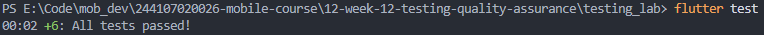
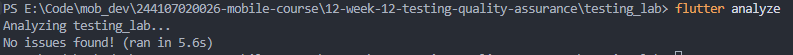

# Praktikum 1 : Pengujian unit dan kasus tepi

1. Menentukan jenis pengujian

| Jenis | Bagian yang diperiksa |
| --- | --- |
| Unit | Aturan validasi judul tugas dan hasil pemanggilan repository |
| Widget | Tampilan halaman, pesan validasi, dan interaksi tombol simpan |
| Integrasi | Alur pengguna mengisi judul, menyimpan tugas, lalu melihatnya di daftar |

2. Skenario pengujian

| Skenario | Contoh input | Hasil yang diharapkan |
| --- | --- | --- |
| Judul berisi teks | `'Belajar Flutter'` | Diterima |
| Judul memiliki spasi di awal dan akhir | `'  Baca materi  '` | Diterima |
| Judul hanya satu karakter | `'A'` | Diterima |
| Teks kosong | `''` | Ditolak |
| Judul hanya berisi spasi | `'   '` | Ditolak |
| Judul hanya berisi tab dan baris baru | `'\t\n'` | Ditolak |

Judul satu karakter menjadi kasus batas karena aturan hanya mengharuskan adanya teks. Spasi, tab, dan baris baru termasuk kasus tepi yang bisa terlihat terisi meskipun tidak memiliki judul.

3. Membuat fungsi validasi

kode di [lib/is_valid_task_title.dart](testing_lab/lib/is_valid_task_title.dart)

4. Menulis pengujian dengan Arrange, Act, Assert

test ada di [test/is_valid_task_title_test.dart](testing_lab/test/is_valid_task_title_test.dart)

Setiap pengujian menggunakan pola berikut:

- Arrange: siapkan judul pada variabel `title`.
- Act: panggil `isValidTaskTitle(title)` dan simpan hasilnya pada `result`.
- Assert: periksa `result` dengan `expect`, menggunakan `isTrue` atau `isFalse`.

5. Temuan

Pemeriksaan `isNotEmpty` saja masih menerima input yang hanya berisi spasi. Penggunaan `trim()` membuat input tersebut ditolak. Pengujian juga memastikan judul yang benar tetap diterima walaupun memiliki spasi di awal dan akhir.

# Pengujian

1. Flutter test

Enam pengujian unit validasi judul tugas lulus.

2. Flutter analyze

Analisis kode tidak menemukan masalah.

