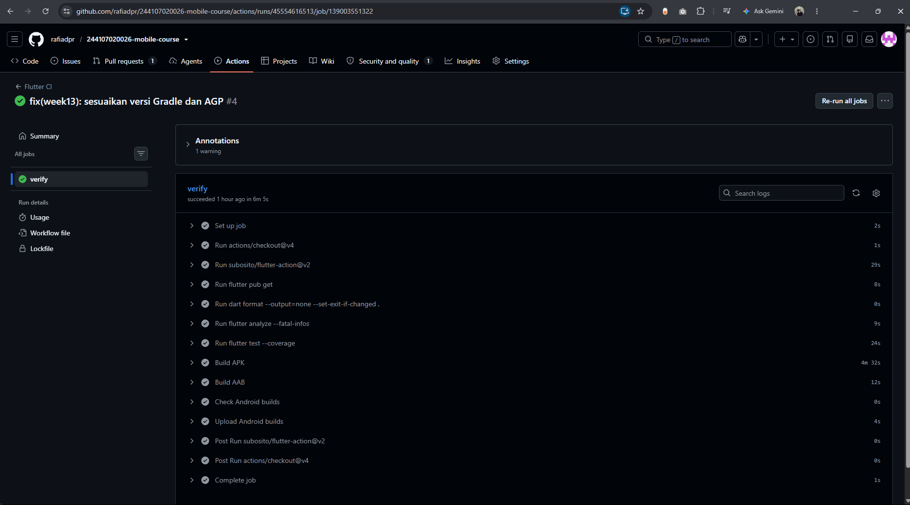

# Praktikum 1 : Membuat workflow CI Flutter

1. [Campus Notify](campus_notify/) disalin dari proyek pertemuan 10 dan dipakai sebagai proyek Flutter untuk latihan CI.
2. [Workflow Flutter CI](../.github/workflows/flutter-ci.yml) dibuat di folder `.github/workflows` pada root repository.
3. Workflow berjalan saat ada push ke `main` atau `feature/week13-ci-cd-automation`, serta saat ada pull request ke `main`.

| Pemeriksaan | Fungsi |
| --- | --- |
| `flutter pub get` | Memasang dependensi proyek |
| `dart format --output=none --set-exit-if-changed .` | Memeriksa format kode Dart |
| `flutter analyze --fatal-infos` | Memeriksa masalah kode, termasuk temuan tingkat info |
| `flutter test --coverage` | Menjalankan tes dan mencatat cakupan pengujian |

Workflow memakai izin `contents: read` untuk membaca kode. Saat ada push baru ke branch yang sama, GitHub Actions membatalkan proses CI sebelumnya yang masih berjalan.

# Praktikum 2 : Membangun dan menyimpan APK dan AAB

1. [Workflow Flutter CI](../.github/workflows/flutter-ci.yml) membangun APK dan AAB setelah tes lulus.
2. Workflow memeriksa kedua berkas hasil build, lalu mengunggahnya sebagai satu artefak bernama `android-builds`.

| Perintah | Hasil |
| --- | --- |
| `flutter build apk --release` | `app-release.apk` untuk instalasi dan uji coba di perangkat Android |
| `flutter build appbundle --release` | `app-release.aab` untuk distribusi melalui Google Play |

# Praktikum 3 : Menjalankan dan mengevaluasi pipeline

1. Push commit [4a089cc](https://github.com/rafiadpr/244107020026-mobile-course/commit/4a089cc2c61c7ce1f7fa8b5d099d3c086b89e973) ke branch `feature/week13-ci-cd-automation` memicu [Flutter CI #4](https://github.com/rafiadpr/244107020026-mobile-course/actions/runs/45554616513).
2. Job `verify` berhasil dalam 6 menit 5 detik. Artefak `android-builds` berisi `app-release.apk` dan `app-release.aab`.

| Pemeriksaan | Hasil |
| --- | --- |
| Format Dart | Lulus |
| Analisis Flutter | Lulus |
| Tes Flutter dengan cakupan pengujian | Lulus |
| Build APK dan AAB | Keduanya berhasil |
| Unggah artefak | `android-builds` tersedia di bagian **Artifacts** |

# Praktikum 4 : Versi, pemeriksaan, dan keamanan

1. Versi di `pubspec.yaml` adalah `1.0.0+1`. Rilis perbaikan berikutnya direncanakan memakai `1.0.1+2`. Angka patch naik dari `0` ke `1`, sementara nomor build naik dari `1` ke `2` untuk unggahan berikutnya. Tag `v1.0.1` akan menandai commit rilis setelah CI lulus.
2. CI mengambil dependensi, memeriksa format Dart, menjalankan analisis Flutter, dan menjalankan tes dengan cakupan pengujian. Setelah semua pemeriksaan lulus, CI membangun APK dan AAB, memastikan kedua berkas ada dan tidak kosong, lalu mengunggahnya ke `android-builds`.

| Risiko keamanan | Penanganan |
| --- | --- |
| Build praktikum memakai kunci debug | Gunakan kunci unggah untuk menandatangani AAB sebelum dikirim ke Google Play. |
| Token, kata sandi, atau keystore bocor lewat repository atau log | Simpan di GitHub Actions Secrets. Batasi akses ke workflow rilis yang memerlukan persetujuan dan jaga agar nilai rahasia tidak muncul di log. |
| Nilai `--dart-define` yang masuk ke aplikasi bisa dibaca dari hasil build | Gunakan untuk konfigurasi publik seperti URL API. Simpan kredensial layanan di server. |

# Tugas dan refleksi

## Refleksi

1. Masalah apa yang ditemukan otomatis sebelum perubahan di-merge?

Pada run pertama, analisis menemukan 11 impor `flutter/material.dart` yang sudah usang. Workflow berhenti di langkah analisis. Langkah itu lulus setelah impor diganti ke `material_ui`.

2. Informasi apa yang Anda butuhkan untuk menyelidiki build yang gagal?

Saya perlu tahu commit yang dijalankan, langkah yang gagal, dan pesan error di log. Saat build APK gagal, log menunjukkan versi AGP yang dipakai dan versi minimum yang diminta Flutter. Dari situ saya tahu bagian konfigurasi Android yang perlu diperbaiki.

3. Bagian mana yang masih perlu persetujuan atau pemeriksaan manual sebelum rilis?

Saya masih perlu mencoba APK di perangkat Android untuk memeriksa izin mikrofon dan memastikan notifikasi bisa diterima. Sebelum AAB diunggah ke Google Play, tanda tangan rilis perlu diperiksa dan publikasi perlu disetujui.
